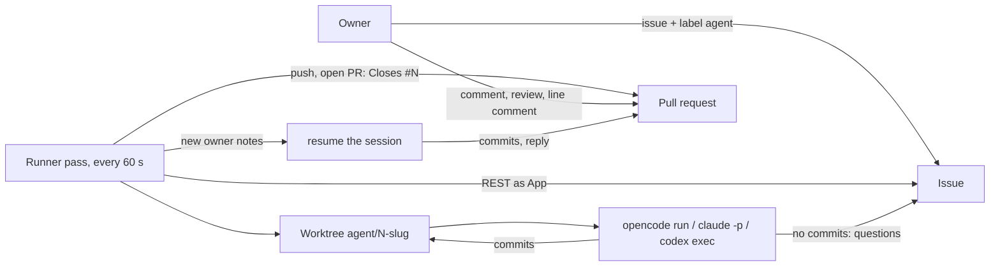
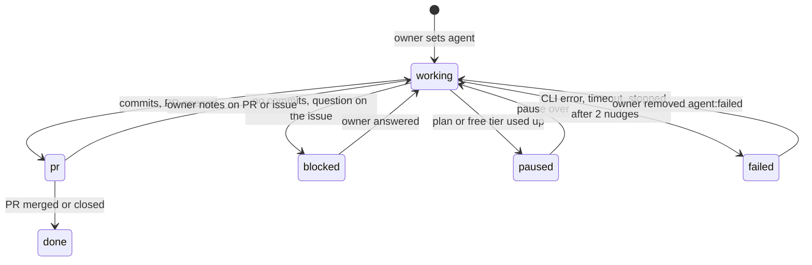

# famulus spec

Stage: 0.1.0. famulus guards pull requests of the watched repositories and never merges;
the coding runner is frozen: it works, but gets no new features.

## Contents

1. What it is
2. Flow
3. States
4. Parts
5. Agents
6. Boundaries
7. Scenarios
8. Decisions
9. Out of scope

## 1. What it is

A Docker container on the owner's machine. One process polls the watched GitHub
repositories every minute and has two roles.

The guard reviews open pull requests: code checks first (CI of the head and the base, gate
files), then a read-only Claude review against the linked issue and the project rules. The
result is one check `famulus` and one review per head SHA.

The coding runner (frozen): an issue with the label `agent` goes to a coding agent: OpenCode,
Claude Code or Codex. The agent commits on a branch. The runner pushes the branch and opens
a pull request as a GitHub App bot. Later notes of the owner on the pull request or the issue
go back to the same agent session. When the agent lacks something, it asks in a comment.

Not: a GitHub Action, a hosted service, an auto-merger, a queue for several users.

Name: famulus (a scholar's assistant), checked 2026-10-28; GitHub App `famulus-agent`, because
the account `famulus` exists. Trademarks and domains not checked.

Prior art of the runner, checked on 2026-10-28. Close ones:
AgentConnect (ACP, App bot, PR feedback resumes the author session, but GitHub only by webhook
and four services), propr (label, Docker, subscriptions, but a new session per comment),
OpenHands Agent Canvas (Claude Code and Codex over ACP, issue-to-PR automation, but the user's
token as identity), optio and kelos (Kubernetes). Noctra, DevIntern and Shikumi claim polling
with both CLIs, checked from READMEs only. None found polls without a public URL, posts as a
bot and resumes the same session in one small binary; that is why famulus stays its own.

## 2. Flow

One pass, per repository:

1. Every task in state `pr`: a merged or closed PR finishes the task (`done`, worktree
   removed). New owner notes on the PR or the issue resume the session.
2. Open issues with the label `agent`. A new one starts: label `agent:working`, worktree from
   the fresh base branch, first prompt = agent rules + issue + owner comments. At most
   `daily_limit` (default 5) new issues start per UTC day; the rest wait with the label `agent`
   alone. Retries, answers and PR notes do not count.
3. A `blocked` issue resumes when the owner wrote after the agent's question.
4. After a run: changes the agent left uncommitted are committed by the runner; new commits
   are pushed; the final message becomes the PR description (first PR), a reply on the PR,
   or a comment on the issue when there are no commits (state `blocked`).
5. Before a PR exists, a run with no commits and no `## Questions` heading is unfinished: the
   runner sends the same session a nudge, up to 2 times, then the task fails.

Each completed pass logs one `pass done` line with repository, handled issue and followed PR
counts, errors and duration. Repository, PR and issue failures count; their causes are logged
where handled. A failed run already reported on its issue (comment and `agent:failed`) is a
task failure, not a runner failure, and does not count. An interrupted pass counts as failed.

With `alert_repo` set (empty by default), three consecutive failed passes or five minutes
without a successful pass during a failure open `famulus: failure`, labeled `famulus:alert`.
The check runs at pass completion; it does not interrupt a busy agent. The runner looks up
the open labeled issue on every pass, including after restart, and comments at most hourly.
The first successful pass comments `recovered, down from X to Y` and closes the issue. If
GitHub was unreachable, the pending outage is opened and closed on recovery. Pending outages
before issue creation are held in memory. Alerts publish safe error categories; arbitrary
CLI and remote error text stays in the local log.

A repository with `review = true` also gets a review pass before its tasks. Only the owner's
non-draft PRs are reviewed, once per head SHA; the verdict is stored in state and found
again among the bot's reviews after a restart. Code decides first, on the check `famulus`:

| Condition | Check | Review |
|---|---|---|
| CI of the head still running | `in_progress`, "Waiting for CI" | none |
| CI of the head failed | `in_progress`, failed jobs listed | none |
| CI of the base branch failed | `in_progress`, "<base> is red" | none |
| files from `gate_files` changed, no `gate-change` label | `completed` failure | `REQUEST_CHANGES` |
| otherwise | `queued`, then the agent review below | agent's verdict |

`gate_files` (default: workflows, linter and gitleaks configs, `Makefile`, `*.mk`) protects
CI from being weakened inside the PR it checks; a rename counts by both names. famulus
checks that the label is present, not who set it: labels need triage access, which only
the owner holds.
The verdict is per SHA, so a label added after `REQUEST_CHANGES` takes effect on the next
push. An unchanged check text is not sent again.

The agent review runs `claude` read-only (R7; model and effort from config, the run timeout) in a new
session, in a detached worktree of the head SHA that is removed afterwards; nothing made there
is pushed. The prompt is `rules/REVIEW.md` (the maintainer checklist and the answer format),
the PR title and body, linked issues written by the owner (others' issues are left out, R2),
the changed files and the diff against the base, cut at 200 KB. The final message is one JSON
object: `verdict` approve or request_changes, `summary`, `findings` with file, line,
severity must or should, why and scenario. The runner checks it: `request_changes` exactly
when a must finding exists. A bad answer gets one retry in the same session; a second bad
answer or a failed run posts a `COMMENT` "famulus review failed" and fails the check, with no
approval and no retry until a new push. The verdict is `APPROVE` or `REQUEST_CHANGES`; a
finding whose line is inside a diff hunk becomes a line comment, others go to the body. A
used-up plan pauses `claude` for tasks and reviews alike; the PR stays queued until then. GitHub
refusing a line comment moves all findings to the body; a review GitHub still refuses (400, 413, 422) fails the check and is not re-run on that SHA; after a passing refusal (auth,
rate limit, outage) the next pass publishes the same answer without a new model run. After a restart the
bot's published review finishes the check without a new model run. At most
`review_daily_limit` (default 20) model runs per UTC day; past it the check stays queued
with the reason. The panel lists the guarded PRs (SHA, verdict, check title) and today's runs.

The panel shows the last pass, last successful pass (UTC), consecutive failures and last
error. `/healthz` returns 200 only when a successful pass finished less than
five minutes ago; startup and stale health return 503. Docker probes it with curl. A long
agent run can make health stale; unhealthy does not restart the container.

## 3. States

The issue label `agent:<state>` mirrors the task state, so the owner sees it on GitHub.

A used-up plan is not a failure: the runner rests that agent until the time the provider
named, else for `limit_pause` (1 hour), comments once on the issue with the retry time and
retries by itself. While an agent rests, its other issues wait in the queue without comments.
Limits of the free OpenCode Zen models are not published (checked 2026-10-25); a used-up free
tier answers HTTP 429 `FreeUsageLimitError`, error type `provider.free-limit`.

`state.json` on the work volume keeps what GitHub does not: agent, session, branch, PR
number, `since` (the creation time of the newest owner note already given to the agent), the
pause end of each agent and the count of new issues started on the current UTC day.

## 4. Parts

| Part | Role |
|---|---|
| `internal/config` | `famulus.toml`: owner, label, interval, timeout, agents, repositories |
| `internal/github` | REST client as GitHub App: JWT, installation tokens, issues, labels, notes, PRs |
| `internal/workspace` | one clone per repository, one worktree per issue, push without force |
| `internal/agent` | the three CLIs behind one call: prompt and session in, session and final message out |
| `internal/state` | `state.json`, written through a temporary file |
| `internal/yard` | the pass, state changes, prompts |
| `internal/yard/review.go`, `agentreview.go` | the guard: code checks, the agent review, the check and the review |
| `internal/yard/alert.go` | failure issue lifecycle in `alert_repo`, restart lookup and hourly updates |
| `internal/panel` | read-only admin page on `panel` (default `:8080`): health, tasks and guarded PRs, last log lines |
| `rules/AGENTS.md` | rules every first prompt of the runner starts with |
| `rules/REVIEW.md` | the review checklist and answer format |

CI of a SHA combines the latest check runs (without our own) and legacy statuses: failure
wins over pending, neutral and skipped count as success. Issue links come from
`Closes|Fixes|Resolves #N` in the PR body.

## 5. Agents

| Agent | New run | Resume | Login |
|---|---|---|---|
| OpenCode | `opencode run --format json --model M` | `--session ID` | free Zen models need none |
| Claude Code | `claude -p --output-format json --dangerously-skip-permissions --model M --effort E` | `--resume ID` | `CLAUDE_CODE_OAUTH_TOKEN` from `claude setup-token` |
| Codex | `codex exec --json --dangerously-bypass-approvals-and-sandbox -o FILE -` | `codex exec resume ID` | `codex login --device-auth` once, inside the container |

Subscriptions (checked 2026-10-27): Anthropic forbids routing subscription credentials on
behalf of other users (code.claude.com/docs/en/legal-and-compliance); OpenAI says not to use
a ChatGPT login in automation for public repositories (developers.openai.com/codex/noninteractive).
famulus serves one owner on own repositories.

The container is the sandbox, so the permission bypass flags are allowed inside it. The
agent's environment has no `FAMULUS_*` variables: it never sees the App key and cannot
push. A resume that fails starts a new session with the rules and a summary of the task.

## 6. Boundaries

What the runner does not do on any input:

- R1. Takes only issues with the label `agent`; on GitHub only people with triage rights
  can set labels.
- R2. Passes to the agent only notes written by `owner`. A stranger's comment never reaches a
  prompt.
- R3. Never merges, never pushes to the base branch, never force-pushes.
- R4. One agent at a time; a run is cut at `timeout`.
- R5. Gives the agent no GitHub token and no App key.
- R6. Updates only `famulus` check runs belonging to the configured GitHub App.
- R7. Runs the review agent read-only: file reading tools inside the review worktree, no shell,
  writes, network, settings or MCP servers. The worktree loses the PR's agent files (`.claude`,
  `CLAUDE.md`, `CLAUDE.local.md`, `.mcp.json`) and symlinks first; the diff still shows them. An
  answer holding a runner secret, also spaced out or reversed, is not published.

## 7. Scenarios

| ID | Given | Expect |
|---|---|---|
| S1 | issue labeled `agent`, agent commits | branch pushed, PR `Closes #N`, label `agent:pr` |
| S2 | agent makes no commits | its message is an issue comment, label `agent:blocked` |
| S3 | blocked issue, owner answers | same session resumed with the answer |
| S4 | owner review or line comment on the PR | same session resumed, new commits pushed, reply on the PR |
| S5 | stranger comments | nothing reaches the agent (R2) |
| S6 | PR merged or closed | task `done`, worktree removed |
| S7 | agent CLI fails | comment with the cause, label `agent:failed`; removing the label retries |
| S8 | resume fails (session lost) | new session with rules and task summary |
| S9 | agent leaves changes uncommitted | runner commits them, they reach the PR |
| S10 | container stops mid-run | no failure is recorded; the task restarts on the next start |
| S11 | agent reports a used-up plan, also only in the OpenCode error log while the CLI waits | label `agent:paused`, one comment with the retry time, automatic retry |
| S12 | agent ends its turn with no commits and no questions | same session nudged up to 2 times; still nothing - `agent:failed` with a comment |
| S13 | `daily_limit` new issues already started today | further new issues wait untouched until the next UTC day; owner notes on open PRs still run |
| S14 | repository, PR or issue fails during a pass | error cause logged once, one pass summary counts the failure; panel records no success; a run failure reported on its issue does not count |
| S15 | three consecutive failed passes, or five minutes without success during failure | one labeled failure issue opens in `alert_repo`; an empty setting disables alerts |
| S16 | an alert remains open, including after restart | reuse it; failure comments no more than hourly |
| S17 | first successful pass after an alert | recovery comment with outage period, then close; retrying closure does not duplicate recovery comments |
| S18 | GitHub unreachable throughout a qualifying outage | open and immediately close an outage issue on recovery |
| S19 | startup, or last successful pass at least five minutes ago | `/healthz` returns 503; fresh success returns 200; panel shows health |
| S20 | error contains credentials or arbitrary agent output | public alert contains only a safe cause category |
| S21 | another App has a `famulus` check on the same SHA | create our own check; later updates address only our App's check (R6) |
| S22 | owner's PR, CI pending or failed, or base red | check `famulus` waits with the reason; no review |
| S23 | PR changes a gate file without the `gate-change` label | `REQUEST_CHANGES` and failed check, once per SHA, also after restart |
| S24 | stranger's or draft PR | not reviewed |
| S25 | code checks pass, agent finds a must issue | `REQUEST_CHANGES`, findings in the diff as line comments, the rest in the body, check failure |
| S26 | agent answers without valid JSON, or the verdict contradicts the findings | one retry in the same session; twice bad - `COMMENT` "review failed", check failure, no approval |
| S27 | linked issue written by someone else | left out of the review prompt (R2) |
| S28 | review agent hits a used-up plan | agent paused, check queued "paused", review runs after the pause |
| S29 | `review_daily_limit` model runs done today | check queued "Daily review limit reached", no model run; reviewed the next UTC day |
| S30 | review prompt or code asks the agent to run a command, read a file outside the worktree or print a secret | no tool for it; an answer holding a runner secret is not published, the review fails (R7) |

## 8. Decisions

- Own poller instead of claude-code-action: polling needs no public URL, one runner serves
  all repositories, any CLI with a subscription works.
- GitHub App bot instead of the owner's token: the owner can review the bot's PRs formally,
  and the bot's comments are told apart by author.
- The runner, not the agent, pushes and opens the PR: deterministic, and the agent holds
  no credentials.
- Rules travel in the prompt, not in files in the image: the same text for all three CLIs.
- famulus is a guard outside the PR (2026-11-03): CI runs from the PR itself, so a PR can
  weaken its own checks; famulus runs from main and only reads. The coding runner is frozen.
- simplified: one agent at a time, first 100 issues and review notes per call. Issue comments
  are paginated so long-lived alerts can deduplicate recovery comments.

## 9. Out of scope

Acceptance gates and scores of admitd, parallel agents, tasks from tix, notifications outside
GitHub, Linux builds of macOS-only projects (tarn's Swift part does not build in the container).
